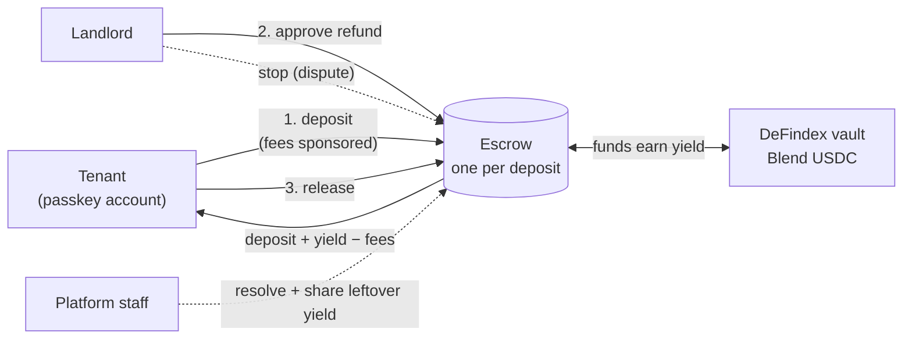

# Pledge · rental deposits that earn yield on Stellar

**Pledge turns a room-rental deposit into its own escrow smart contract on Stellar.** While the lease lasts, the deposit earns variable yield in a DeFindex vault. When the lease ends, it goes back to the tenant once the landlord approves. Tenants never touch crypto: they sign in with a passkey, pay no network fees and fund the deposit from their bank.

Built for **HackMeridian 2026 · Genesis track** · runs on **Stellar testnet**.

🎬 Demo: _coming soon_ · 📹 Video: _coming soon_

---

## 1. Problem

A rental deposit is one or two months of rent that the tenant hands over at the start of the lease. Today:

- **The money sits idle for the whole tenancy.** It usually sits in the landlord's account, where nobody can verify it, and earns nothing for anyone.
- **Getting it back depends on the landlord's goodwill.** Refunds are slow, deductions are hard to challenge, and a dispute means paperwork, lawyers or simply giving up.
- **Large landlords manage hundreds of deposits by hand,** with no common record of who paid what and when.

## 2. Solution

Every deposit gets **its own escrow contract**, with clear rules everyone can check on-chain:

- **The deposit is locked, not handed over.** Neither party can move it alone.
- **It earns yield.** The escrow deposits the funds into a DeFindex vault (Blend USDC). The yield is **variable and never risk-free**.
- **It comes back when the landlord approves.** The landlord approves the refund, and the tenant releases the deposit plus its yield, minus fees, to their own account.
- **Disputes have a clear path.** Only the landlord can stop the refund. Platform staff then decide the split: any deduction goes to the landlord and the rest goes back to the tenant. Leftover yield is shared according to the jurisdiction's rule (MVP: Portugal).
- **No crypto UX for the tenant.** Passkey account (Face ID or fingerprint, no seed phrase), sponsored fees and a bank on-ramp through an anchor.

## 3. How it works



### Lifecycle of a deposit

| Step | Who | What happens on-chain |
|---|---|---|
| **Create** | Platform (server) | Deploys a Trustless Work escrow with fixed roles: landlord = approver, tenant = release signer and receiver, staff = dispute resolver, platform treasury = platform address. |
| **Deposit** | Tenant (passkey) | `fund_escrow`. The tenant signs with their passkey and our Relayer pays the fees. The escrow moves the funds into the DeFindex vault. |
| **Approve** | Landlord | `approve_milestone`: the landlord agrees to return the deposit. |
| **Release** | Tenant (passkey) | `release_funds`: the vault is withdrawn and the tenant receives deposit + yield − fees. |
| **Stop** *(dispute)* | Landlord | `dispute_escrow`. Our API only allows it before the landlord approves. |
| **Resolve** | Staff | `resolve-dispute`: the funded amount is split (deduction to the landlord, the rest to the tenant). If the vault lost value, the remaining balance is split. |
| **Share leftover yield** | Staff | `withdraw-remaining-funds`: optional platform fee first, then the jurisdiction's tenant/landlord share. |

### Architecture

```
apps/web            Next.js · landlord and tenant app (Pledge). Also serves the API under /api.
apps/backoffice     Next.js · staff console (disputes).
apps/api            Hono · backend. Talks to the Trustless Work API (server-side key), builds
                    Soroban transactions for passkey accounts, relays only platform transactions.
packages/trustless  Typed Trustless Work client + domain rules: roles, states, exact splits, rounding.
packages/wallet     Passkey smart wallet (smart-account-kit) + sponsored Relayer with a strict policy.
packages/anchor     SEP-24 bank on-ramp (simulated ramp on testnet).
contracts/          Rust/Soroban: our own escrow + factory (a Trustless Work fork). Plan B, not used in the demo.
```

**Security by design**
- **What you see is what you sign.** Before the passkey prompt, the wallet decodes the authorization and checks the contract, the function and the **exact amount the user saw**.
- **The Relayer only sponsors our own passkey accounts** calling escrow functions, with at most one token transfer, and that transfer must go to the escrow itself.
- **The server checks every Trustless Work deployment transaction before the treasury signs it** (deployer contract, function, source account, auth and fee cap).
- **The API never signs on behalf of users**, rate-limits by IP and only forwards transactions to platform contracts.
- **Amounts are exact.** We use 7-decimal integers (`bigint`) end to end. On-chain balances are truncated, never rounded up, so we can never distribute more than the escrow holds.

## 4. How to test it

**Requirements:** Node 22+, pnpm 10 (`corepack enable` picks the pinned version), and Chrome or Edge for passkeys.

```bash
git clone https://github.com/jzelada97/stellar-fianzas.git && cd stellar-fianzas
pnpm install

# Unit tests and type checks for every package
pnpm test && pnpm typecheck
```

### Run the app locally

1. Copy the environment template into the web app. Next.js reads it from the app folder:
   ```bash
   cp .env.example apps/web/.env.local
   ```
   Fill in:
   - `TW_API_KEY`: Trustless Work yield API key.
   - `TREASURY_SECRET`: testnet treasury key that signs escrow deployments.
   - `RELAYER_API_KEY`: free testnet key from <https://channels.openzeppelin.com/testnet/gen>.
   - `RAMP_FAUCET_SECRET`: testnet account that funds the simulated bank deposit.
2. Start the apps:
   ```bash
   pnpm dev:web          # http://localhost:3000  · landlord and tenant (+ API at /api)
   pnpm dev:backoffice   # http://localhost:3001  · staff
   ```
3. Check the API: <http://localhost:3000/api/health> shows the active backend (`trustless` = Plan A).

### Demo flow
1. **Landlord** creates a deposit and shares the invitation link.
2. **Tenant** opens the link, creates a passkey account, adds funds through the bank on-ramp (simulated on testnet) and deposits.
3. **Landlord** approves the refund.
4. **Tenant** releases the deposit and receives the deposit + yield − fees.
5. *(Dispute path)* The landlord stops the deposit and staff resolve it from the backoffice.

### Verify it on testnet
A full dispute cycle made through the Trustless Work API with our domain logic (20 USDC escrow [`CDIGN3HM…CH2A`](https://stellar.expert/explorer/testnet/contract/CDIGN3HMVVDZI6Y6HP5OH2AVIAONFWWJYDLCKCEOJ55DQ5NEXJ2KCH2A)):

| Step | Transaction |
|---|---|
| Deploy escrow | [`9f084fac…`](https://stellar.expert/explorer/testnet/tx/9f084fac1de05dec045aa78abb11b8a3a5081c0a2298855d0a8a0388f9e0de25) |
| Deposit 20 USDC (goes into the vault) | [`88dc4b76…`](https://stellar.expert/explorer/testnet/tx/88dc4b76ae1c02e19abf24e47be13a65c0a620749a62ac8f4ea316d9f4ec6703) |
| Landlord stops | [`7851f3f7…`](https://stellar.expert/explorer/testnet/tx/7851f3f77d336bc86772ca7091e06547c5d23a6b24010ac50684bd068286a347) |
| Staff resolve (18 to the tenant, 2 to the landlord) | [`410cfbd2…`](https://stellar.expert/explorer/testnet/tx/410cfbd242eae8bd2194f7e012b84d1c71a9f9da430390b64928d10022d25998) |
| Leftover yield shared (treasury, tenant, landlord) | [`c24a1957…`](https://stellar.expert/explorer/testnet/tx/c24a1957585f8a4418b941ec0b56a690d6a4307fef3d273d30ed681386f7ab05) |

## 5. Stellar integration

| Feature | What we use it for | Why Stellar |
|---|---|---|
| **Soroban smart contracts** | One [Trustless Work](https://www.trustlesswork.com) single-release escrow per deposit (TrustYield), with roles, approval, dispute and resolution. | Every deposit is isolated and its rules can be checked by anyone. |
| **DeFindex vault on Blend** | The escrowed USDC earns variable yield while the lease lasts. | A composable DeFi vault the escrow can deposit into natively. |
| **Passkey smart accounts** | Tenants sign with Face ID or a fingerprint through a WebAuthn verifier contract ([`smart-account-kit`](https://www.npmjs.com/package/smart-account-kit)). | No seed phrases and no wallet app: crypto stays invisible. |
| **Fee sponsorship** | The [OpenZeppelin Relayer (Channels)](https://channels.openzeppelin.com) pays the network fees for passkey transactions, behind our own policy. | The tenant needs no XLM. |
| **USDC + SEP-24 anchor** | Deposits are in USDC. Tenants fund them from their bank through an anchor (simulated on testnet). | Native stablecoins and fiat on-ramps. |
| **Soroban RPC** | Reads, simulation and submission. | Fast finality and low fees for a consumer product. |

**Testnet addresses**

| | Address |
|---|---|
| USDC (Blend testnet, SAC) | [`CAQCFVLO…RCJU`](https://stellar.expert/explorer/testnet/contract/CAQCFVLOBK5GIULPNZRGATJJMIZL5BSP7X5YJVMGCPTUEPFM4AVSRCJU) |
| DeFindex vault (Trustless Work default) | [`CCG3G4YU…S7ZJ`](https://stellar.expert/explorer/testnet/contract/CCG3G4YUO3FOPCTZXDSXOB3VXLOWVW3G5FB6RJNB45TYQ34SBS7TS7ZJ) |
| Trustless Work escrow deployer | [`CBTENJ2A…GEJI`](https://stellar.expert/explorer/testnet/contract/CBTENJ2ATPZTN5ZE5LMAQVX64DF3OMNZHVIUSMB7CQSEK2R6EN4ZGEJI) |
| Escrow wasm hash | `828ae58429c6bf7a2da16784d89871f11e07fd7a82326de7f0817c80c02e4b95` |
| Passkey WebAuthn verifier | [`CC7EKIHQ…OM3F`](https://stellar.expert/explorer/testnet/contract/CC7EKIHQP3TN4CARQDND6CEOY2UXLWWC2X5GHTD5NLAT7BG5GPZIOM3F) |

## 6. Technologies

- **Frontend:** Next.js 16, React 19, Tailwind CSS 4.
- **Backend:** Hono 4, Zod 4, deployed inside the Next.js app (one origin).
- **Stellar:** `@stellar/stellar-sdk` 16, Soroban RPC, Trustless Work API (TrustYield), DeFindex, `smart-account-kit` 0.8, OpenZeppelin Channels, SEP-24.
- **Smart contracts (Plan B):** Rust, `soroban-sdk` 28.
- **Tooling:** TypeScript 6, pnpm workspaces, Vitest, GitHub Actions CI. Built by a 4-person team in 28 hours with Claude Code and a custom team harness ([`docs/HARNESS.md`](docs/HARNESS.md)).

## 7. Known limitations

This is a hackathon MVP focused on the happy path, on **testnet only**.

- **Trustless Work charges 0.3% on everything withdrawn, deposit included.** The tenant only gets 100% back once the yield exceeds that fee (about three weeks at a 6% yearly rate).
- **On a normal refund, all the yield goes to the tenant.** Trustless Work's `release_funds` pays everything to the receiver, so the jurisdiction's yield rule (Portugal: yield to the landlord) only applies on the dispute path. The platform also only earns a fee there.
- **No stop bond, expert payment or timeouts yet.** If the landlord disappears, the tenant cannot claim the deposit automatically. Our own escrow contracts (`contracts/`, Plan B) implement these, but they are not deployed for the demo.
- **The bank on-ramp is simulated on testnet.**
- **A passkey lives in the browser or password manager where it was created,** so demo accounts must be created on the final domain and device.
- **The yield is variable and never guaranteed.** It depends on the Blend pool.
- **Security headers (CSP) are still being finished** and are not part of the MVP.

## 8. Next steps

- Mainnet launch with a real SEP-24 anchor in Portugal and Spain.
- Charge platform and Trustless Work fees on the yield only, so the deposit always comes back in full.
- Jurisdiction-aware refunds, plus a stop bond, expert review and timeouts (ported from our Plan B contracts).
- Portfolio dashboard and bulk operations for large landlords.
- External security audit.

## Team

| Role | Who |
|---|---|
| Escrow contracts and Trustless Work client | Carlos · [@CarlosJX7](https://github.com/CarlosJX7) |
| DeFi, infrastructure and API (integrator) | Jose Zelada · [@jzelada97](https://github.com/jzelada97) |
| No-crypto onboarding (passkeys, anchor) | Ricardo Matos · [@RicardoMatosR](https://github.com/RicardoMatosR) |
| UX/UI and pitch | Diego Matos Romero · [@Diego-Matoss](https://github.com/Diego-Matoss) |

More: architecture contract [`docs/INTERFACES.md`](docs/INTERFACES.md) · decisions [`docs/DECISIONS.md`](docs/DECISIONS.md) · team workflow [`docs/HARNESS.md`](docs/HARNESS.md).
