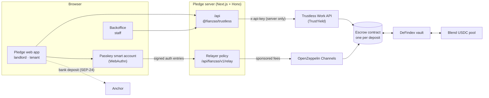

# Pledge · rental deposits that earn yield on Stellar

**Pledge turns a room-rental deposit into its own escrow smart contract on Stellar.** While the lease lasts, the deposit earns variable yield in a DeFindex vault. When the lease ends, it goes back to the tenant once the landlord approves. Tenants never touch crypto: they sign in with a passkey, pay no network fees and fund the deposit from their bank.

Built for **HackMeridian 2026 · Genesis track** · runs on **Stellar testnet**.

---

## 1. Problem

A rental deposit is one or two months of rent that the tenant hands over at the start of the lease. Today:

- **The money sits idle for the whole tenancy.** It usually sits in the landlord's account, where nobody can verify it, and earns nothing for anyone.
- **Getting it back depends on the landlord's goodwill.** Refunds are slow, deductions are hard to challenge, and a dispute means paperwork, lawyers or simply giving up.
- **Large landlords manage hundreds of deposits by hand,** with no common record of who paid what and when.

## 2. Solution

Every deposit gets **its own escrow contract** ([Trustless Work](https://www.trustlesswork.com) single-release escrow with yield), with rules everyone can check on-chain:

- **The deposit is locked, not handed over.** Neither party can move it alone.
- **It earns yield.** The escrow deposits the funds into a DeFindex vault on Blend (USDC). The yield is **variable and never risk-free**.
- **It comes back when the landlord approves.** The landlord approves the refund, and the tenant releases the deposit plus its yield, minus fees, to their own account.
- **Disputes have a clear path.** Only the landlord can stop the refund, for free and before approving it. Pledge staff then decide the split: any deduction goes to the landlord and the rest goes back to the tenant. Leftover yield is shared according to the jurisdiction's rule (MVP: Portugal).
- **The tenant is never stuck.** If the landlord neither approves nor stops the refund within 30 days of the lease end, the tenant can claim it and gets the whole deposit back. Pledge guarantees this, not the contract.
- **No crypto UX for the tenant.** Passkey account (Face ID or fingerprint, no seed phrase), sponsored fees and a bank on-ramp through an anchor.

## 3. How it works

### Architecture



- **Landlords and staff** (Stellar G accounts) sign the transactions that the Trustless Work API builds.
- **Tenants** (passkey C accounts) can't be signers in that API, so our server builds those calls against the escrow contract. The tenant signs only the authorization with their passkey, and the Relayer submits it and pays the fees.

### Lifecycle of a deposit

| Step | Who | What happens on-chain |
|---|---|---|
| **Create** | Pledge (server) | The platform treasury deploys a Trustless Work escrow with fixed roles: landlord = approver, tenant = release signer and receiver, staff = dispute resolver, treasury = platform. The server checks the transaction before signing it. |
| **Deposit** | Tenant (passkey) | `fund_escrow`, fees sponsored. The escrow moves the funds into the DeFindex vault. |
| **Approve** | Landlord | `approve_milestone`: the landlord agrees to return the deposit. |
| **Release** | Tenant (passkey) | `release_funds`: the vault is withdrawn and the tenant receives deposit + yield − fees. |
| **Stop** *(dispute)* | Landlord | `dispute_escrow`, only before approving. |
| **Resolve** | Staff | `resolve-dispute`: the funded amount is split (deduction to the landlord, the rest to the tenant). If the vault lost value, the remaining balance is split. |
| **Share leftover yield** | Staff | `withdraw-remaining-funds`: optional platform fee first, then the jurisdiction's tenant/landlord share. |
| **Claim** *(no answer 30 days after the lease ends)* | Tenant, then staff | The tenant opens a dispute (`dispute_escrow`) and the staff resolve it with no deduction. The server checks the deadline on-chain first. Guaranteed by Pledge, not by the contract. |

### What's live, simulated and planned

| Feature | Status | Where |
|---|---|---|
| Escrow lifecycle on testnet: create, deposit, approve, release, stop, resolve, share yield | ✅ **Live** (API) | [#93](../../pull/93), [#97](../../pull/97), [#104](../../pull/104). Verified with real transactions in [#80](../../issues/80) and [#84](../../issues/84) |
| Yield in the DeFindex vault (Blend USDC) | ✅ **Live** | Observed on testnet in [#80](../../issues/80) |
| Passkey signing, with a check of what the user signs | ✅ **Live** | [#66](../../pull/66), [#79](../../pull/79) |
| Sponsored fees through the Relayer, with a strict policy | ✅ **Live** | [#81](../../pull/81) |
| API protections: rate limits, API keys, platform-only transactions | ✅ **Live** | [#85](../../pull/85), [#90](../../pull/90), [#109](../../pull/109) |
| Landlord and tenant screens (Pledge), connected to the API | ✅ **Live** | [#100](../../pull/100), [#113](../../pull/113), [#126](../../pull/126) |
| Passkey deposit and release in the browser, end to end | 🟡 **Being fixed** (the passkey deposit fails in the Relayer simulation) | [#82](../../issues/82), [#128](../../pull/128) |
| Tenant claim 30 days after the lease ends (guaranteed by Pledge) | 🟡 **Live in the API**, not yet in the web app | [#115](../../issues/115), [#122](../../pull/122) |
| Bank on-ramp | 🟣 **Simulated** on testnet (capped faucet ramp) | [#74](../../issues/74) |
| Security headers (CSP) | ⏳ **Planned** | [#96](../../pull/96) |
| Fees charged on the yield only, so the deposit always comes back in full | ⏳ **Planned** | [`DECISIONS.md`](docs/DECISIONS.md) |
| Using the same passkey on another device | ⏳ **Planned** | [#82](../../issues/82) |

### Technical decisions
Full log in [`docs/DECISIONS.md`](docs/DECISIONS.md).
- **One Trustless Work escrow per deposit, through their yield API (TrustYield)** instead of a custom contract. It is audited code, and the DeFindex yield comes built in.
- **The API key never leaves the server.** Every Trustless Work call goes through our API ([`packages/trustless`](packages/trustless), [`apps/api`](apps/api)).
- **Passkey actions are built against the contract and relayed** ([#61](../../issues/61), [#66](../../pull/66)), because the Trustless Work API only accepts G accounts as signers.
- **The treasury deploys the escrows from the server** ([#84](../../issues/84)), after checking that the transaction is exactly a call to the Trustless Work deployer ([#104](../../pull/104)).
- **Deposit lists come from the Trustless Work index by role** (landlord = approver, tenant = receiver), so we keep no database.
- **MVP mode until delivery** ([#106](../../pull/106)): only the happy path blocks a merge.

### Security notes
- **What you see is what you sign.** Before the passkey prompt, the wallet decodes the authorization and checks the contract, the function and the **exact amount the user saw**.
- **The Relayer only sponsors our own passkey accounts** calling escrow functions, with at most one token transfer, and that transfer must go to the escrow itself.
- **The server checks every deployment transaction before the treasury signs it:** deployer contract, function, source account, authorization and fee cap.
- **The API never signs on behalf of users**, rate-limits by IP and only forwards transactions to escrows whose platform is our treasury.
- **Amounts are exact.** We use 7-decimal integers (`bigint`) end to end. Balances are truncated, never rounded up, so we can never distribute more than the escrow holds.

## 4. How to test it

**Requirements:** Node 22+, pnpm 10 (`corepack enable` picks the pinned version), and Chrome or Edge for passkeys.

```bash
git clone https://github.com/jzelada97/Pledge.git && cd Pledge
pnpm install
pnpm test && pnpm typecheck      # unit tests and type checks for every package
```

### Run it locally

1. Copy the environment template into the web app. Next.js reads it from the app folder:
   ```bash
   cp .env.example apps/web/.env.local
   ```
   | Variable | What it is |
   |---|---|
   | `TW_API_KEY` | Trustless Work yield API key (server only) |
   | `TREASURY_SECRET` | Testnet treasury key that deploys the escrows |
   | `RELAYER_API_KEY` | Free testnet key from <https://channels.openzeppelin.com/testnet/gen> |
   | `RAMP_FAUCET_SECRET` | Testnet account that funds the simulated bank deposit |
2. Start the apps:

   | Command | URL | What |
   |---|---|---|
   | `pnpm dev:web` | <http://localhost:3000> | Landlord and tenant app, plus the API at `/api` |
   | `pnpm dev:backoffice` | <http://localhost:3001> | Staff console |
   | `pnpm --filter @fianzas/api dev` | <http://localhost:8787/api/health> | API on its own (export the same variables first) |
3. <http://localhost:3000/api/health> returns `backend: "trustless"` when the Trustless Work key is set.

### Demo flow
1. **Landlord** creates a deposit and shares the invitation link.
2. **Tenant** opens the link, creates a passkey account, adds funds through the bank on-ramp (simulated) and deposits.
3. **Landlord** approves the refund.
4. **Tenant** releases the deposit and receives the deposit + yield − fees.

### Verify it on testnet
A full dispute cycle through the Trustless Work API with our deposit rules (20 USDC escrow [`CDIGN3HM…CH2A`](https://stellar.expert/explorer/testnet/contract/CDIGN3HMVVDZI6Y6HP5OH2AVIAONFWWJYDLCKCEOJ55DQ5NEXJ2KCH2A)):

| Step | Transaction |
|---|---|
| Deploy escrow | [`9f084fac…`](https://stellar.expert/explorer/testnet/tx/9f084fac1de05dec045aa78abb11b8a3a5081c0a2298855d0a8a0388f9e0de25) |
| Deposit 20 USDC (goes into the vault) | [`88dc4b76…`](https://stellar.expert/explorer/testnet/tx/88dc4b76ae1c02e19abf24e47be13a65c0a620749a62ac8f4ea316d9f4ec6703) |
| Landlord stops | [`7851f3f7…`](https://stellar.expert/explorer/testnet/tx/7851f3f77d336bc86772ca7091e06547c5d23a6b24010ac50684bd068286a347) |
| Staff resolve (18 to the tenant, 2 to the landlord) | [`410cfbd2…`](https://stellar.expert/explorer/testnet/tx/410cfbd242eae8bd2194f7e012b84d1c71a9f9da430390b64928d10022d25998) |
| Leftover yield shared (treasury, tenant, landlord) | [`c24a1957…`](https://stellar.expert/explorer/testnet/tx/c24a1957585f8a4418b941ec0b56a690d6a4307fef3d273d30ed681386f7ab05) |

## 5. Stellar integration

| Feature | What we use it for | Why Stellar |
|---|---|---|
| **Soroban smart contracts** | One Trustless Work single-release escrow per deposit, with roles, approval, dispute and resolution. | Every deposit is isolated and its rules can be checked by anyone. |
| **DeFindex vault on Blend** | The escrowed USDC earns variable yield while the lease lasts. | A composable DeFi vault the escrow can deposit into natively. |
| **Passkey smart accounts** | Tenants sign with Face ID or a fingerprint through a WebAuthn verifier contract ([`smart-account-kit`](https://www.npmjs.com/package/smart-account-kit)). | No seed phrases and no wallet app: crypto stays invisible. |
| **Fee sponsorship** | The [OpenZeppelin Relayer (Channels)](https://channels.openzeppelin.com) pays the network fees for passkey transactions, behind our own policy. | The tenant needs no XLM. |
| **USDC + SEP-24 anchor** | Deposits are in USDC. Tenants fund them from their bank through an anchor (simulated on testnet). | Native stablecoins and fiat on-ramps. |
| **Soroban RPC** | Reads, simulation and submission. | Fast finality and low fees for a consumer product. |

**Testnet addresses**

| | Address |
|---|---|
| USDC (Blend testnet, SAC) | [`CAQCFVLO…RCJU`](https://stellar.expert/explorer/testnet/contract/CAQCFVLOBK5GIULPNZRGATJJMIZL5BSP7X5YJVMGCPTUEPFM4AVSRCJU) |
| DeFindex vault (Trustless Work default) | [`CCG3G4YU…S7ZJ`](https://stellar.expert/explorer/testnet/contract/CCG3G4YUO3FOPCTZXDSXOB3VXLOWVW3G5FB6RJNB45TYQ34SBS7TS7ZJ) |
| Trustless Work escrow deployer (creates one escrow per deposit) | [`CBTENJ2A…GEJI`](https://stellar.expert/explorer/testnet/contract/CBTENJ2ATPZTN5ZE5LMAQVX64DF3OMNZHVIUSMB7CQSEK2R6EN4ZGEJI) |
| Escrow wasm hash | `828ae58429c6bf7a2da16784d89871f11e07fd7a82326de7f0817c80c02e4b95` |
| Passkey WebAuthn verifier | [`CC7EKIHQ…OM3F`](https://stellar.expert/explorer/testnet/contract/CC7EKIHQP3TN4CARQDND6CEOY2UXLWWC2X5GHTD5NLAT7BG5GPZIOM3F) |
| Platform treasury | [`GBNOMT2V…L4N7`](https://stellar.expert/explorer/testnet/account/GBNOMT2VMMNGWPENBY2FP66ASRMUVSJRCJZWIZ2ENZ45OYJKSL67L4N7) |

## 6. Technologies

- **Frontend:** Next.js 16, React 19, Tailwind CSS 4.
- **Backend:** Hono 4 and Zod 4, served inside the Next.js app (one origin).
- **Stellar:** `@stellar/stellar-sdk` 16, Soroban RPC, Trustless Work API (TrustYield), DeFindex, `smart-account-kit` 0.8, OpenZeppelin Channels, SEP-24.
- **Tooling:** TypeScript 6, pnpm workspaces, Vitest, GitHub Actions CI. Built by a 4-person team in 28 hours with Claude Code and a custom team harness ([`docs/HARNESS.md`](docs/HARNESS.md)).

### Repository map

```
apps/web            Landlord and tenant app (Pledge). Also serves the API under /api.
apps/backoffice     Staff console: resolve disputes and share the leftover yield.
apps/api            Server: Trustless Work API, transactions for passkeys, Relayer, rate limits.
packages/trustless  Typed Trustless Work client and deposit rules: roles, states, exact splits.
packages/wallet     Passkey smart wallet and sponsored Relayer with a strict policy.
packages/anchor     SEP-24 bank on-ramp (simulated ramp on testnet).
deployments/        Testnet addresses and configuration.
```

## 7. Known limitations

This is a hackathon MVP focused on the happy path, on **testnet only**.

- **Trustless Work charges 0.3% on everything withdrawn, deposit included.** The tenant only gets 100% back once the yield exceeds that fee (about three weeks at a 6% yearly rate).
- **On a normal refund, all the yield goes to the tenant.** Trustless Work's `release_funds` pays everything to the receiver, so the jurisdiction's yield rule (Portugal: yield to the landlord) only applies on the dispute path. The platform also only earns a fee there.
- **The 30-day claim relies on Pledge, not on the contract.** The Trustless Work escrow has no deadlines, so our server and staff carry it out. It is ready in the API but not yet in the web app.
- **The bank on-ramp is simulated on testnet.**
- **A passkey lives in the browser or password manager where it was created,** so demo accounts must be created on the final domain and device.
- **The yield is variable and never guaranteed.** It depends on the Blend pool.

## 8. Next steps

- Mainnet launch with a real SEP-24 anchor in Portugal and Spain.
- Charge platform and Trustless Work fees on the yield only, so the deposit always comes back in full.
- Jurisdiction-aware refunds on the normal path, the claim button in the web app, and an on-chain claim deadline in the escrow so the guarantee no longer depends on Pledge.
- Portfolio dashboard and bulk operations for large landlords.
- External security audit.

## Team

| Role | Who |
|---|---|
| Trustless Work client and deposit rules | Carlos · [@CarlosJX7](https://github.com/CarlosJX7) |
| DeFi, infrastructure and API (integrator) | Jose Zelada · [@jzelada97](https://github.com/jzelada97) |
| No-crypto onboarding (passkeys, Relayer, anchor) | Ricardo Matos · [@RicardoMatosR](https://github.com/RicardoMatosR) |
| Pitch | Diego Matos Romero · [@Diego-Matoss](https://github.com/Diego-Matoss) |

The product front end (`apps/web`, `apps/backoffice`) is shared by the whole team. More: API contract [`docs/INTERFACES.md`](docs/INTERFACES.md) § 8 · decisions [`docs/DECISIONS.md`](docs/DECISIONS.md) · team workflow [`docs/HARNESS.md`](docs/HARNESS.md).
