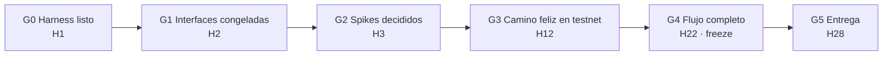
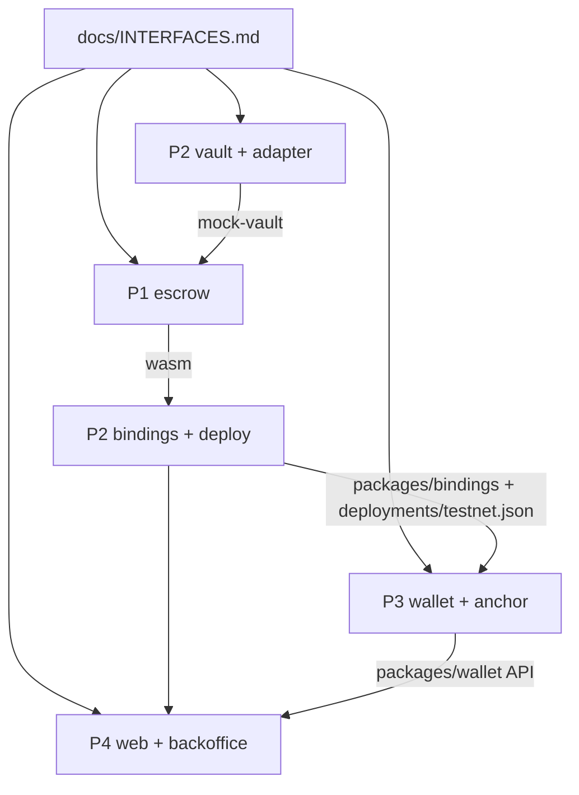

# Pipeline de 28 horas

Cada fase termina en una **puerta (gate)**. No se pasa de fase hasta cumplirla. Si una puerta se retrasa más de 1 hora, se recorta alcance (ver "Qué se recorta primero"), nunca se recortan los tests del contrato.

Hora 0 = inicio de la hackatón.

## Dependencias entre roles

Regla: **cada flecha tiene un mock** desde la hora 2. Nadie espera a otro rol para avanzar.

| Quien consume | Lo que necesita | Mock mientras tanto |
|---|---|---|
| P1 | Vault real | `contracts/mock-vault` (P2 lo entrega en H2–3; P1 puede usar un stub local hasta entonces) |
| P3, P4 | Bindings del contrato | Tipos TS escritos a mano a partir de INTERFACES, en su propia carpeta, borrados cuando llegan los bindings |
| P4 | `packages/wallet` | Un `FakeWallet` en `apps/web` con la misma API que `docs/INTERFACES.md` § Wallet |
| P4 | Contrato desplegado | Datos de ejemplo con la forma de `get(id)` |

---

## Fase 0 · Harness (H0–H1) → G0
| Rol | Tareas |
|---|---|
| P2 | Crear el repo, `node scripts/harness/init-github.mjs` (labels y protección de `main`), rellenar `harness/team.json` con los usuarios de GitHub, `sync-codeowners`. Esqueleto del monorepo: workspace Cargo y pnpm, CI. |
| P1, P3, P4 | Clonar, `node scripts/harness/setup.mjs P<n>`, instalar toolchain (Rust + `stellar` CLI, Node 20+, pnpm, gh). Probar `/estado`. |
| Todos | Acordar las dependencias npm y crates principales (P2 las instala de una vez para evitar choques en el lockfile). |

**G0:** los 4 tienen `setup` hecho, `/estado` funciona y un PR de prueba de cada uno ha pasado la CI.

## Fase 1 · Interfaces (H1–H2) → G1
| Rol | Tareas |
|---|---|
| P1 | Revisar y cerrar las firmas, eventos y errores del contrato en `docs/INTERFACES.md`. |
| P2 | Cerrar la interfaz del `yield_adapter`, el formato de `deployments/testnet.json` y el contrato del mock-vault. |
| P3 | Cerrar la API de `packages/wallet` y `packages/anchor`. |
| P4 | Pantallas en baja fidelidad de las 3 vistas y los presets de política. |

**G1:** PR de `docs/INTERFACES.md` fusionado con la aprobación de los 4. A partir de aquí, cualquier cambio en INTERFACES necesita un issue "Cambio de interfaz" y la aprobación del dueño de cada área afectada.

## Fase 2 · Spikes (H1–H3) → G2
| Rol | Spike | Decisión |
|---|---|---|
| P2 | Deposit y withdraw **desde un contrato** contra DeFindex y contra Blend en testnet, con `authorize_as_current_contract`. | DeFindex o Blend |
| P3 | `smart-account-kit` + OpenZeppelin Relayer: crear cuenta con passkey y firmar una llamada a un contrato de prueba sin XLM. Probar SEP-45 contra testanchor. | Kit de passkeys y si el anchor va con passkey o con plan B |

**G2:** las dos decisiones anotadas en `docs/DECISIONS.md`.

## Fase 3 · Construcción en paralelo (H3–H10)
| Rol | Entregables |
|---|---|
| P1 | `propose`, `accept_and_fund`, `approve_release`, `settle` con fee y política, tests de reparto (0/50/100 %, pérdida). |
| P2 | `yield_adapter` real, mock-vault, `scripts/deploy`, `scripts/fund` (cuentas demo con BlendUSDC), `scripts/bindings.sh`. |
| P3 | `packages/wallet`: `createAccount`, `connect`, `signAndSend` vía Relayer. Primera versión de `packages/anchor`. |
| P4 | Panel del casero y flujo móvil del inquilino contra mocks. |

## Fase 4 · Integración 1 (H10–H12) → G3
P2 dirige la integración. Deploy en testnet, bindings regenerados y P3/P4 cambian mocks por lo real.

**G3:** en testnet, con **dos cuentas con passkey**: propuesta → acepta y deposita → los dos aprueban → saldos correctos para inquilino, casero y tesorería. Se deja creado un escrow "largo" para que acumule yield hasta la demo.

## Fase 5 · Camino de parada y anchor (H12–H16)
Turnos de descanso de 2 en 2: **P1+P3** descansan en H12–H14 y **P2+P4** en H14–H16.

| Rol | Entregables |
|---|---|
| P1 | `stop`, `assign_expert`, `record_report`, `resolve`, `claim_after_timeout` + tests. |
| P2 | Script e2e del camino de parada. Cuenta de staff. |
| P3 | Anchor SEP-24 con testanchor o plan B. |
| P4 | Backoffice del staff. |

## Fase 6 · Integración 2 (H16–H22) → G4
**G4 (feature freeze en H22):** flujo completo en testnet (feliz + parada + timeout), backoffice operativo y depósito vía anchor o plan B. A partir de aquí solo se aceptan PR `fix(...)`.

## Fase 7 · Pulido y entrega (H22–H28) → G5
| Rol | Entregables |
|---|---|
| P1 | Revisión de seguridad del contrato con la checklist de `contracts/escrow/CLAUDE.md`. |
| P2 | README con diagrama, direcciones de contratos y cómo reproducir la demo. |
| P3 | Cuentas demo preparadas en dos móviles. |
| P4 | Slides, guion y vídeo de respaldo. |
| Todos | Dos ensayos completos de la demo (H24 y H26). |

**G5:** entrega enviada antes de H28 con repo público, vídeo y slides.

---

## Rituales
- **Check-in cada 2 h** (H2, H4, H6…), 5 minutos: cada uno dice qué ha fusionado, qué le bloquea y qué fusiona en las próximas 2 h. Se mira `/estado`.
- **Ventanas de merge:** se fusiona a `main` al menos una vez cada 2 h por persona. Un PR abierto más de 2 h se parte o se cierra.
- **Revisión en menos de 15 minutos.** Si nadie revisa, avisa en el canal del equipo.
- **Fuente de verdad:** issues y PR de GitHub. El chat del equipo es para avisar, no para decidir.

## Qué se recorta primero
1. Anchor real → plan B (ramp simulado, marcado como tal).
2. `claim_after_timeout` en la UI (se queda solo en el contrato y los tests).
3. Backoffice → se opera con un script.
4. Yield real → mock-vault con rendimiento simulado (se dice en la demo).

Nunca se recorta: tests del contrato, flujo con passkey ni camino feliz en testnet.
