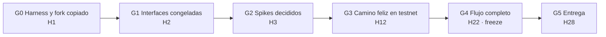
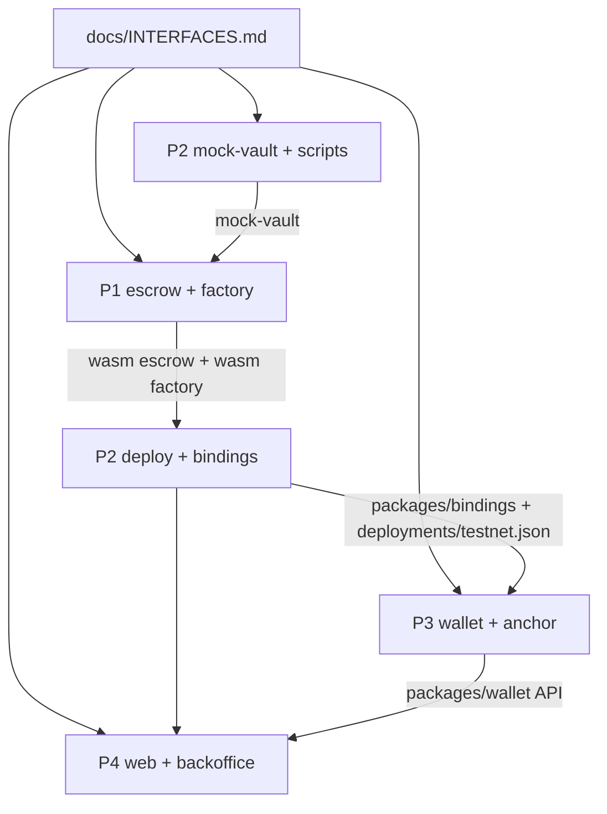

# Pipeline de 28 horas

> **Histórico.** Este plan describe el plan B (escrow y factory propios), **descartado** el 26-oct. Solo existe el plan A: ver `docs/DECISIONS.md` y `packages/trustless/CLAUDE.md`. Para las fases, quédate solo con lo que no sea de contratos.

Cada fase termina en una **puerta (gate)**. No se pasa de fase hasta cumplirla. Si una puerta se retrasa más de 1 hora, se recorta alcance (ver "Qué se recorta primero"), nunca se recortan los tests del contrato ni de la factory.

Hora 0 = inicio de la hackatón. Arquitectura de referencia: `.kiro/pipeline/architecture.md` (v2: fork de Trustless Work + `FianzaFactory`), § 10 (spike) y § 11 (orden por rol). Seguridad: `.kiro/pipeline/security.md` § 13.

## Dependencias entre roles

Regla: **cada flecha tiene un mock** desde la hora 2. Nadie espera a otro rol para avanzar.

| Quien consume | Lo que necesita | Mock mientras tanto |
|---|---|---|
| P1 | Vault de DeFindex | `contracts/mock-vault` con el subconjunto de INTERFACES § 5 (P2 lo entrega en H3; P1 usa un stub local hasta entonces) |
| P1 (factory) | Wasm del escrow | El wasm del propio escrow compilado en local (`contractimport!`); en los tests, `upload_contract_wasm` |
| P3, P4 | Bindings de factory y escrow | Tipos TS escritos a mano a partir de INTERFACES, en su propia carpeta, borrados cuando llegan los bindings (H5) |
| P4 | `packages/wallet` | Un `FakeWallet` en `apps/web` con la misma API que INTERFACES § 8 |
| P4 | Contratos desplegados | Fixtures con la forma de `FianzaSummary` (`factory.get_fianzas`) y de `EscrowView` (`escrow.get_view`) |

---

## Fase 0 · Harness y fork (H0–H1) → G0
| Rol | Tareas |
|---|---|
| P1 | Setup. **H0:30:** copiar `contracts/escrow/src/**` de TW `single-release-develop-v2` @ `1d22d0c1b9c5788f4fd7184e42024bbe10303756` a `contracts/escrow/`, con la cabecera de origen en cada archivo. `cargo build --target wasm32v1-none --release` y **tests upstream en verde** con nuestro toolchain. Medir el tamaño del wasm. `contracts/escrow/NOTICE.md` y `contracts/factory/NOTICE.md` con la atribución a TW. |
| P2 | Esqueleto del monorepo: workspace Cargo con `soroban-sdk = "28.0.0"` y perfil release copiado de TW, workspace pnpm. CI con el build del wasm del escrow **antes** de `cargo test -p factory`. Identidades del CLI (una por rol). PR de `harness/team.json` con el área `api` (ya incluido en este PR). |
| P3, P4 | Clonar, `node scripts/harness/setup.mjs P<n>`, instalar toolchain (Node 20+, pnpm, gh). Probar `/estado`. P4: esqueleto Next ×2. |
| Todos | Acordar las dependencias npm y crates principales (P2 las instala de una vez para evitar choques en el lockfile). |

**G0:** los 4 tienen `setup` hecho, `/estado` funciona, un PR de prueba de cada uno ha pasado la CI y el fork compila en local (o se ha activado el plan B de H1:30).

## Fase 1 · Interfaces (H1–H2) → G1
| Rol | Tareas |
|---|---|
| P1 | Con `/lock interfaces`: cerrar firmas, eventos y errores de escrow (§ 2) y factory (§ 3). Empezar el **recorte del fork** (quitar las funciones del upstream que lista INTERFACES § 2, security N-2), `types.rs`, `error.rs` y `split` con su matriz. |
| P2 | Revisar § 5 (vault) y § 6 (`deployments/testnet.json`). Empezar `mock-vault` con la interfaz de DeFindex. Lleva la sección API (INTERFACES § 8) al `/lock interfaces`. |
| P3 | Cerrar § 7–§ 9: API de `packages/wallet` y `packages/anchor`, `WalletErrorCode` y `RelayPolicy`. |
| P4 | Pantallas en baja fidelidad: creación con selector de estrategia y aviso de riesgo, aceptación del inquilino, parada con bond, backoffice y a quién va el rendimiento (lo fija la jurisdicción, sin presets: DECISIONS y #16). |

**G1:** PR de `docs/INTERFACES.md` fusionado con la aprobación de los 4. A partir de aquí, cualquier cambio en INTERFACES necesita un issue "Cambio de interfaz" y la aprobación del dueño de cada área afectada.

## Fase 2 · Spikes (H0:30–H3) → G2
| Hora | Rol | Spike | Criterio de éxito | Si falla |
|---|---|---|---|---|
| H0:30–H1:30 | P1 | **Compilar el fork:** v2 @ `1d22d0c` con nuestro toolchain y tests upstream | Compila y los tests pasan | **H1:30:** se pasa a v1 `single-release-develop` @ `f0b706e` con approver = casero y `release_signer` = inquilino. Las interfaces no cambian |
| H1:00–H2:00 | P1 | **Quórum de 2:** con el fork recortado, `approvers = [L]` y `target = 2`; `fund_escrow` añade T; `approve_release(L)` y `approve_release(T)` liquidan. Con `Address::generate` **y** con una cuenta contrato (`__check_auth` real), sin `mock_all_auths` | Liquida solo en la 2.ª aprobación; la misma parte dos veces → `AlreadyApproved` | Lógica de quórum propia (≈30 líneas) en `milestone.rs` |
| H1:00–H3:00 | P2 | **Depositar desde un contrato en el vault de testnet:** (1) `get_assets()`, `get_fees()` y estado de `usdc_paltalabs_vault`; (2) contrato mínimo que hace `deposit([10 USDC],[10 USDC],self,true)` con `authorize_as_current_contract` exacto, mide `balance(self)` y hace `withdraw(shares,[0],self)` midiendo el token; (3) `get_asset_amounts_per_shares`; (4) coste en CPU y footprint | Shares > 0, retiro ≥ depositado − redondeo, sin auth extra | (a) Vault propio con la factory de DeFindex sobre `USDC_blend_strategy` y depósito semilla; (b) en H3, demo con `usdc_mock` (recorte 4) y `yield-adapter` sobre Blend como plan C |
| H2:00–H3:00 | P1 | **Factory mínima:** `create_fianza` despliega el wasm del escrow con `EscrowInit` y `escrow_of(id)` lo devuelve. Medir cuántos despliegues caben en una transacción en testnet | Despliega e inicializa en una llamada | `MAX_BATCH` según la medida, o se recorta el lote (recorte 0) |
| H1–H3 | P3 | **Passkeys contra una instancia de la factory:** passkey → C-address → `{func, auth}` → Channels, firmando `fund_escrow` con su `token.transfer` anidado y sin XLM. Comprobación del wasm hash por `getLedgerEntries`. Probar SEP-45 contra testanchor | La C-address firma `fund_escrow` sin XLM | Kit alternativo (`passkey-kit`) y, para el anchor, ramp simulado (recorte 1) |

**G2 (H3):** en `docs/DECISIONS.md`: base del fork (v2 o v1), vault de testnet (**propio**; `usdc_paltalabs_vault` o `usdc_mock` como plan B), `MAX_BATCH` medido, kit de passkeys y modo del anchor (SEP-24 o simulado).

## Fase 3a · Firmas completas y primer despliegue (H3–H5)
| Rol | Entregables |
|---|---|
| P1 | **Todas las firmas públicas** de escrow y factory compiladas (las de la fase 5 con cuerpo provisional `BadStatus`). Factory: config, registro de estrategias, índices paginados y `register_tenant`. |
| P2 | `deploy.mjs`: sube el wasm del escrow → despliega la factory → `add_strategy` ×3 → `set_default_strategy`. Comprueba el hash del wasm importado por la factory (N-8), el SAC del token (N-4) y la superficie del wasm del escrow (N-2). `bindings.sh` (factory, escrow, token). **Primer despliegue en H5.** **API:** esqueleto de `apps/api` (Hono, Problem Details, `/fianzas/v1/config`, `/stellar/send-transaction`) montado en `apps/web/app/api/[[...path]]/route.ts`, y las lecturas compatibles con TW (`GET /escrow/single-release/v2/{id}`, balances). **Vault propio de DeFindex en testnet** con la factory de DeFindex. |
| P3 | `FakeWallet` y `FakeAnchor`. `createRelayHandler` con la `RelayPolicy` nueva (direcciones dinámicas y topes de N-3) y sus tests de XDR maliciosos. |
| P4 | Bindings reales en cuanto lleguen (H5) y `SignButton`. |

## Fase 3b · Construcción en paralelo (H5–H10)
| Rol | Entregables |
|---|---|
| P1 | `fund_escrow` (invitación, `expected_terms`, vault, `register_tenant` con `try_`), `approve_release` + `settle` + `split`, `cancel`, lecturas, `funding_allowed`. Tests de auth y de estado, test con cuenta contrato y tests de la factory (security 13.5). |
| P2 | `fund.mjs` (trustlines de la tesorería y del receptor del fee de TW, faucet, reserva del mock, bond de los caseros demo). `e2e/happy.mjs`. `e2e/happy.mjs` **a través de la API** (build → firma → send). API: `POST /fianzas/v1/fianzas` (crear vía factory), `fund` compatible con TW, `approve-milestones`, estrategias con APY y comisiones, preview y `/fianzas/v1/relay`. Exporta `@fianzas/api/client`. |
| P3 | `createWallet` real con passkeys y Relayer. |
| P4 | Panel del casero (lista paginada + precio por share), creación con estrategia y enlace de invitación, flujo del inquilino con la comprobación WEB-14. |

## Fase 4 · Integración 1 (H10–H12) → G3
P2 dirige la integración: redeploy, bindings regenerados y `deployments/testnet.json`. P1 fusiona y avisa a P2. P3 y P4 cambian los mocks por lo real (`NEXT_PUBLIC_USE_FAKES=0`) y crean las cuentas demo en el dominio definitivo.

**G3:** en testnet, con **dos cuentas con passkey**: `create_fianza` → `fund_escrow` → los dos aprueban → saldos correctos para inquilino, casero y tesorería. Se deja creada una **fianza larga** con `usdc_fixed` (o `usdc_mock`) para que acumule rendimiento hasta la demo.

## Fase 5 · Camino de parada y anchor (H12–H16)
Turnos de descanso de 2 en 2: **P1+P3** descansan en H12–H14 y **P2+P4** en H14–H16.

| Rol | Entregables |
|---|---|
| P1 (H14–H16) | `stop` + bond, `assign_expert`, `record_report`, `resolve` con `stop_justified`, `claim_after_timeout`, `claim_after_review_timeout` y los tests de security § 12.9 y 13.5. |
| P2 (H12–H14) | `e2e/stop.mjs` (los dos valores de `stop_justified`), `e2e/timeout.mjs`, `e2e/review-timeout.mjs` y cuenta de staff. API: `stop`, `assign-expert`, `record-report`, `resolve` y `claim-*` en `/fianzas/v1`; `dispute` y `resolve-dispute` de TW responden `501` con la ruta nueva. |
| P3 (H14–H16) | Ramp simulado (o SEP-24 si pasó el spike). |
| P4 (H12–H14) | Backoffice del staff con `stop_justified` explícito. |

## Fase 6 · Integración 2 (H16–H22) → G4
| Rol | Entregables |
|---|---|
| P1 | `create_fianzas_batch` **(Could)**, bordes temporales y `evil_vault`. |
| P2 | Redeploy final y AC-13 (despliegue completo en ≤ 10 min). API: `/escrows*`, `/financial`, `/events`, API keys para integradores y prueba con `@trustless-work/escrow-js` cambiando la `baseUrl`. |
| P3 | Robustez: errores de la wallet, reintentos y Relayer caído. |
| P4 | Timeout y revisión vencida en la UI, feed de eventos filtrado por `contractId`, `check-copy.mjs`. |

**G4 (feature freeze en H22):** flujo completo en testnet (feliz + parada + timeout + revisión vencida), backoffice operativo y depósito vía anchor o plan B. A partir de aquí solo se aceptan PR `fix(...)`.

## Fase 7 · Pulido y entrega (H22–H28) → G5
| Rol | Entregables |
|---|---|
| P1 | Checklist de seguridad del contrato **y de la factory** (`contracts/escrow/CLAUDE.md` + security § 13). `NOTICE.md` final. |
| P2 | README con diagrama, direcciones de contratos, cómo reproducir la demo y enlace a los NOTICE. |
| P3 | Cuentas demo preparadas en dos móviles. |
| P4 | Slides ("construido sobre Trustless Work"), guion y vídeo de respaldo. |
| Todos | Dos ensayos completos de la demo (H24 y H26). |

**G5:** entrega enviada antes de H28 con repo público, vídeo y slides.

---

**Carga de P1:** es el rol más cargado (fork + factory). Como P2 ya no construye `yield-adapter`, P2 asume todos los e2e y puede proponer tests de la factory con la etiqueta `cross-area` y la aprobación de P1.

**Carga de P2:** la API son unas 6–8 h repartidas entre H2 y H22, cubiertas con las ~4 h que libera no construir `yield-adapter`. P1 no toca la API. P4 consume `@fianzas/api/client` y, hasta H5, `FakeWallet` y fixtures.

## Rituales
- **Check-in cada 2 h** (H2, H4, H6…), 5 minutos: cada uno dice qué ha fusionado, qué le bloquea y qué fusiona en las próximas 2 h. Se mira `/estado`.
- **Ventanas de merge:** se fusiona a `main` al menos una vez cada 2 h por persona. Un PR abierto más de 2 h se parte o se cierra.
- **Revisión en menos de 15 minutos.** Si nadie revisa, avisa en el canal del equipo.
- **Fuente de verdad:** issues y PR de GitHub. El chat del equipo es para avisar, no para decidir.

## Qué se recorta primero
0. `create_fianzas_batch`.
1. Anchor real → plan B (ramp simulado, marcado como tal).
2. `claim_after_timeout` y `claim_after_review_timeout` en la UI (se quedan en el contrato y los tests).
3. Backoffice → se opera con un script.
4. Yield real → `usdc_mock` con rendimiento simulado (se dice en la demo).

Nunca se recorta: los tests del contrato y de la factory, la factory misma, el flujo con passkey ni el camino feliz en testnet.
